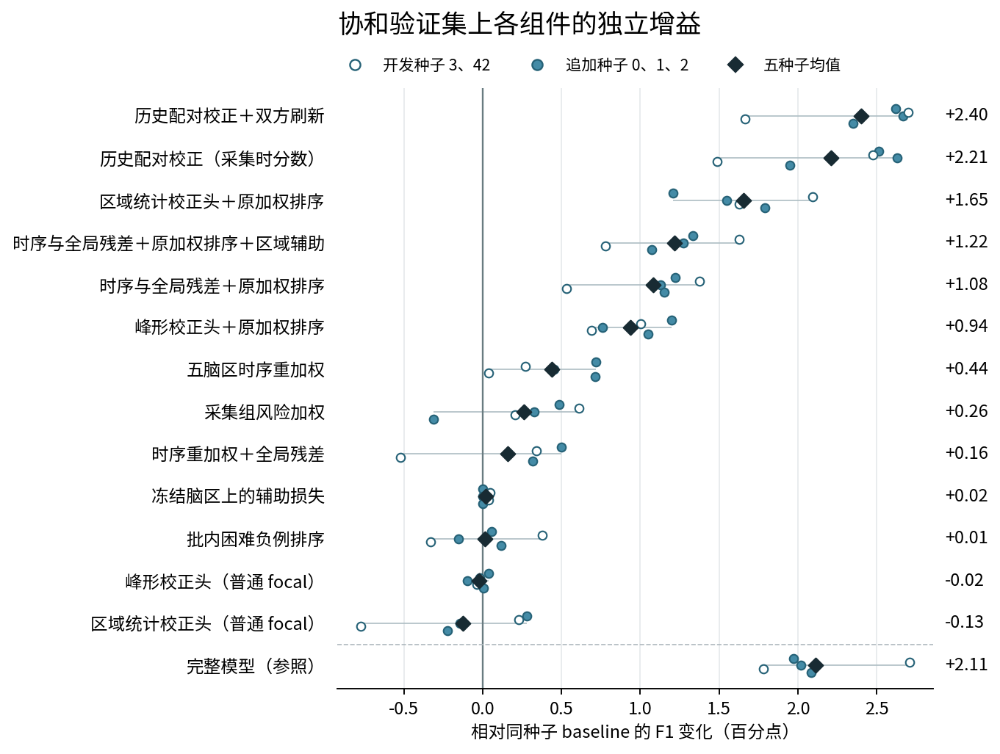

# 六专家 EEG 模型的单组件消融

全局专家角色消融已完成 A–E 五组、五个种子的 25 次配对训练。在协和验证集上，仅让全局专家参与分类融合（C）较关闭两条全局路径（A）平均提高 **0.851 个 F1 点**，五个种子均提高。能力缺口加权（E）相对本次重训基线（D）的平均变化为 **+0.0006 个 F1 点**。[五组完整结果](experiments/global_role_ablation/results/)

在协和验证集上，原六专家基线的五种子平均 F1 为 **69.724**。直接加入历史配对校正得到 **71.936**，再刷新正负双方的分数得到 **72.124 ± 0.214**（种子间样本标准差）。最终变体比基线高 **2.400 个百分点**。五个种子均有增益，四个超过 72。此前完整模型的均值为 **71.837**。[历史配对＋双方刷新](experiments/pairs_refresh/)

每项实验在独立目录中提供训练入口、五个种子的原始 EEG 复核结果、逐轮记录和中文文献说明。13 组消融共有 65 个模型–种子组合，其中 61 个为新训练，4 个复用了历史训练及其原始 EEG 复核。另列十个基线及完整模型对照结果。种子为 0、1、2、3、42。

| 实验 | 五种子平均 F1（%） | 相对基线（百分点） |
|---|---:|---:|
| [六专家基线](controls/baseline/) | 69.724 | +0.000 |
| [历史配对＋双方分数刷新](experiments/pairs_refresh/) | 72.124 | +2.400 |
| [历史正负样本配对](experiments/pairs/) | 71.936 | +2.211 |
| [区域统计校正头＋加权排序](experiments/moment_recipe/) | 71.378 | +1.653 |
| [时序与全局残差＋原加权排序＋区域辅助](experiments/time_aux/) | 70.941 | +1.216 |
| [时序与全局残差＋原加权排序](experiments/time_native/) | 70.806 | +1.082 |
| [峰形校正头＋原加权排序](experiments/peak_native/) | 70.664 | +0.939 |
| [五脑区时序重加权](experiments/regional_time/) | 70.161 | +0.437 |
| [采集组风险加权](experiments/weight/) | 69.987 | +0.263 |
| [时序重加权＋全局残差](experiments/time/) | 69.884 | +0.160 |
| [冻结脑区上的区域辅助损失](experiments/aux_only/) | 69.741 | +0.017 |
| [批内困难负例排序](experiments/rank/) | 69.738 | +0.014 |
| [峰形校正头](experiments/peak/) | 69.702 | -0.022 |
| [区域统计校正头](experiments/moment_plain/) | 69.597 | -0.127 |
| [此前完整模型](controls/fresh_both/) | 71.837 | +2.113 |

各组均直接接到同一基线上。带多个组件的行用于检验依赖关系。例如，在已有配对记忆时重新计算双方分数，平均再提高 **0.189 个百分点**。在时序层可训练时增加区域辅助监督，平均再提高 **0.135 个百分点**。这些条件差值不能相加来分摊完整模型的增益。[配对差值表](results/dependent_contrasts.csv)



## 复核结果

```bash
python3 tools/verify_results.py
```

该命令从混淆矩阵重算 F1、逐种子增益、均值与样本标准差，并核对 1,300 条逐轮记录中的采样顺序、最佳轮次和阈值。验证只需要 Python 标准库。正式训练需要获得授权的协和 EEG 和五个冻结专家检查点。[复现说明](REPRODUCING.md)

## 评估口径

指标为窗口级阳性类别 F1。每组训练 20 轮，每轮 20,000 次采样，batch size 为 128，AdamW 学习率为 0.0005。各组按种子配对共享核心参数的初始化和 40 万次训练采样的顺序。每个模型在协和同一验证集上用 99 个阈值选检查点和阈值，再以原始 EEG 复算混淆矩阵。验证集共 166,079 个窗口，其中 3,471 个阳性。该设计衡量固定数据划分下的种子稳定性，精简配对模型的跨医院效果仍待验证。

[逐种子总表](results/single_component_seeds.csv) · [五种子汇总](results/single_component_summary.csv) · [文献索引](REFERENCES.md) · [共享消融实现](source/I2MOE/test333/fair_single_components/single.py) · [上游 CZB-MOE 固定版本](https://github.com/xiaobri/CZB-MOE/tree/5a2989f20d91e2f197241a7825ab60b1cc41e8a2)
